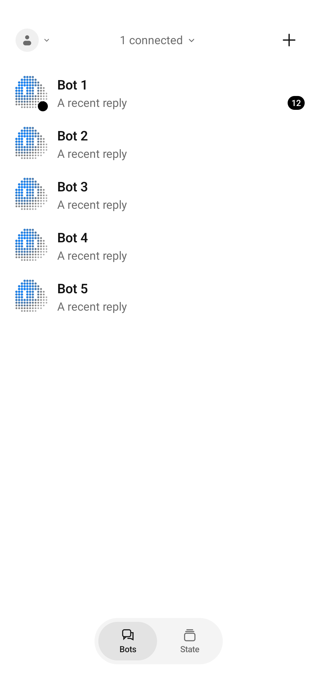
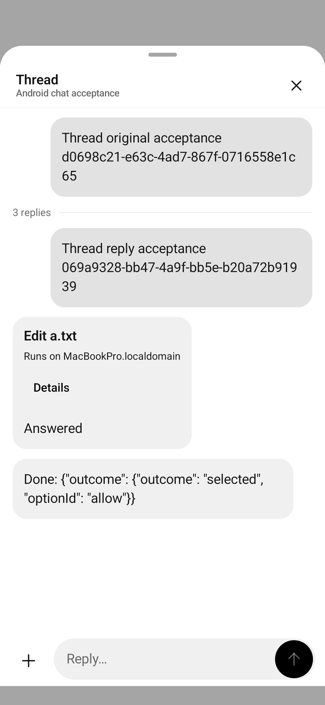
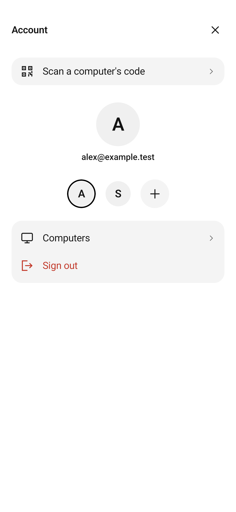

# Android parity and acceptance

Status: **draft for review**. Current scope is polished core flows; full iOS
feature parity and production release readiness remain separate gates. This
checklist supersedes the original October 3 plan and increment notes, and includes
subsequently added iOS memory and voice capabilities.

## Coverage

“Implemented” describes source coverage, not completed acceptance on every device,
provider, permission state and background path.

| Area | Android coverage | Remaining parity or acceptance |
| --- | --- | --- |
| Setup/pairing | Welcome, skip, completion, camera/link, host pinning, Mac/Windows/Linux guidance | Physical optical scan and permission denial |
| Accounts/access | Clerk sessions/providers/switching, scoped storage, access comparison, revocation, route controls, confirmed reset | Current physical restoration, provider browser round trip, failed sign-out and revoked-access walkthrough |
| Computers | One paired computer per account context | Multiple simultaneous connections, combined roster, filtering, collapse and ordering |
| Roster | Live/cached bots, activity, previews, unread, search, pin/hide/restore, groups, create/edit/delete | Persisted manual bot order; multiple computers |
| Conversation | Final replies, notices, permissions, stop/new session, Markdown/code, history, reactions, read state, Full conversation | Complete tool/plan presentation audit; physical keyboard and TalkBack |
| Threads | Original message, counts, thread/full-conversation presenters, independent composer | Current physical navigation/restoration walkthrough |
| Drafts/sends | Scoped text/files, durable nonce, restart recovery, retry/discard, relay waiting/cancel | Live mailbox process death, expiry and delivery/cancel races |
| Attachments | Photos/files/paste, drafts, progress, files-only send, preview, download/share, chunking | Physical picker, permission and sharing checks |
| Bot settings/templates | Models, folders, permissions, notifications, plugins, custom commands, settings JSON export | Complete settings comparison and physical management |
| Groups | Create/edit/delete, attribution, host-owned routing | Current physical walkthrough |
| Memory | Listing and forget one/all | Search/filter/pagination, create/edit, pin/review, history/timeline and backup import/export now on iOS |
| Routines/usage | Editing/control/webhooks, provider windows/freshness, refresh | Current live provider/routine acceptance and error comparison |
| Marketplace/credentials | Agents/connectors/skills, apps, install/configure/remove, OAuth callback, credentials and terminal | Legacy connector sign-out RPC, real provider OAuth, 1Password and physical terminal/keyboard acceptance |
| Voice | English Vosk, device TTS, foreground service, mute/interrupt/end, focus, call notice | Other languages, iOS Cloud Speech/OpenAI Realtime/Gemini Live engines/settings, audible background acceptance |
| Remote screen | Not implemented | WebRTC/signaling, video/input/clipboard/display controls, direct/TURN acceptance |
| Alerts/task state | Encrypted FCM, scoped routing, retirement guards, task notifications | Upstream Firebase/Worker setup, token rotation, revocation, reboot/Doze and background acceptance |
| State/widgets | Bot/usage/provider widgets, configuration, freshness, task state, routing | Physical launcher refresh and stale/offline checks |
| Packaging | Debug, unsigned R8 release, CI, optional Firebase/private configuration | Release ownership, signing/distribution, upgrade/versionCode policy, current minified acceptance |

## Core polish in this draft

- Replace the obsolete `sync` RPC with a finite snapshot of the existing revision-ordered event stream. Wait for its advertised head and release the subscription; reuse this loader for startup, widgets and cold bot links.

- Distinguish offline/refused connections from an empty online roster. Preserve
  cached bots with a saved-data label and show the host's actionable error.
  Creation requires a usable connection; hidden/search empty states are explicit.
- Report failed/offline chat connections accurately in the subtitle.
- Keep the pasted-link camera fallback accessible on short screens and retain
  Windows/Mac/Linux setup choices after navigating back from pairing.
- Allow account confirmations to scroll when height is limited.
- Read upstream debug/release accounts from existing shared plists. Keep private
  package names, Firebase files and deployment tuples outside tracked source;
  reject partial provider overrides.
- Make FCM optional and explain its availability in Account and State. Do not
  request notification permission or schedule registration when unconfigured.
- Add `0004_android_devices.sql` after the existing desktop migration without
  editing shipped upstream migrations. Preserve device/grant/request rows and
  their authorization and uniqueness constraints.
- Require mutating live tests to use an emulator with the controller's explicit
  disposable `fixtureComputerId`.

These are Android adapters for existing behavior. iOS and desktop already have
connection/setup/account presenters, and the terminal roster distinguishes
connection errors from an empty online roster. Their UI is unaffected. Shared
host/cloud/relay changes recognize Android as another phone while retaining
existing authorization and encrypted wire contracts. Product logic stays in the
host.

## Gates before leaving draft

- [x] Current debug/minified release, JVM checks and lint pass.
- [x] Current account, setup, roster, connection, thread and composer UI checks pass.
- [x] Disposable real-host pairing, text, permission and final reply pass.
- [x] Multi-chunk file round trip preserves bytes; files-only send works.
- [x] Independent main/thread drafts survive OS process termination and send once
  with their original nonce.
- [ ] Physical saved account, pinned keys, bots and historical chat survive an
  in-place upgrade without reset, copied credentials or re-pairing.
- [ ] Physical portrait/landscape/foldable, keyboard, large text and TalkBack
  establish usable reading, controls and permission responses.
- [ ] Actual provider sign-in/switching, failed sign-out and revocation are accepted.
- [ ] Owner agrees remaining parity features can follow separately; until then
  keep the PR draft and do not claim full iOS parity.

See the [Android README](../../apps/android/README.md) for build/configuration,
storage boundaries and safe fixtures. Older recorded runs do not replace
acceptance of the current head.

## Shared deployment

The host accepts Android pairing and counts Android streams for phone push
suppression. The cloud accepts Android device records and applies the new
platform migration. The push Worker needs the matching Firebase service account
as an external secret; the client configuration contains no private signing key.

Existing private deployments may have differently named Windows/Android
migrations. Reconcile their actual ledger and schema before deployment; do not
replay old rebuilds or edit the ledger to force agreement. Preserve private keys,
account providers and saved data throughout deployment.

## Current validation

- 88 core JVM checks passed; one opt-in live protocol test skipped. Six app JVM
  checks passed, including connection/empty-state regressions.
- Default debug, instrumentation and unsigned R8 release build; lint reports zero
  errors and 62 warnings. A build with a partial account override is rejected.
- API 34 emulator: 16 portrait UI checks, six short-landscape connection/setup
  checks, two real-host chat/thread checks and both process-death draft phases
  pass. The file round trip covers multiple chunks and compares bytes.
- Screenshots below use fixtures and a disposable fake-agent conversation. They
  contain no personal account or conversation data.
- Physical in-place upgrade preserves the original identity, saved computer and
  mirror files. Saved-account/bot/history UI acceptance still requires unlock.
- Other clients are unchanged and were inspected for corresponding behavior;
  their complete runtime suites were not rerun for this Android-only polish.

